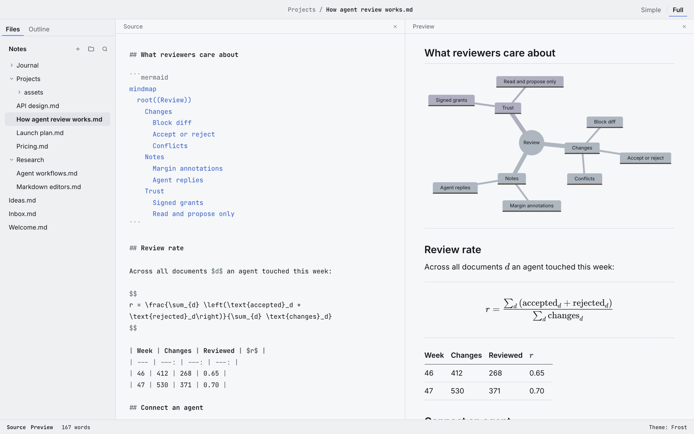
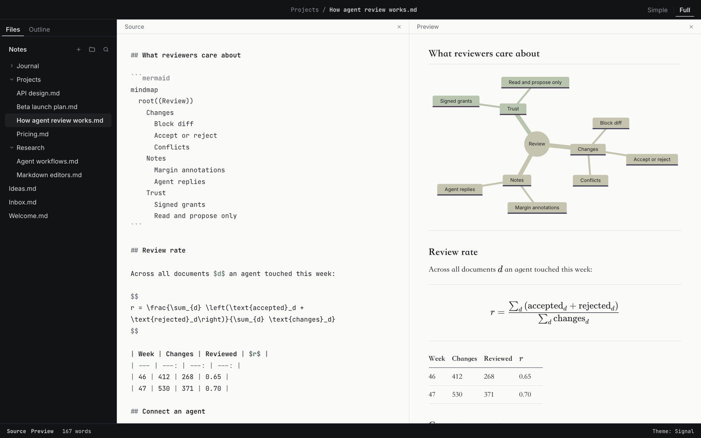

[English](README.md) | 简体中文

<p align="center"></p>

<p align="center">
  <a href="https://github.com/ZYAILLC/zyrite/actions/workflows/ci.yml"></a>
  <a href="https://github.com/ZYAILLC/zyrite/releases/latest"></a>
  <a href="LICENSE"></a>
  
</p>

Claude Code、Cursor、Codex 这类编程 Agent 现在会写大量 Markdown：方案、规格、文档、笔记。Zyrite 是为这件事做的桌面编辑器：Agent 改了文件，你能看清改了哪些地方，按块接受或拒绝；想让它重写某一段，就在页边写条批注，Agent 通过 MCP 读到后去处理。文件始终是你自己磁盘上的普通 `.md`。


## 功能

### 审阅 Agent 的改动

- **按块对比。** Agent 写文件时，不管是直接写磁盘还是通过 MCP，Zyrite 都会拿它和你上次确认的版本比较，标出每一处改动的块。
- **逐处接受或拒绝**，也可以全部接受或全部拒绝。用 `⌥↑` / `⌥↓` 在改动之间跳转。
- **正在写入提示。** 编辑器会跟着 Agent 正在写的那一块滚动。
- **冲突处理。** Agent 的改动和你未保存的修改重叠时，可以打开并排合并视图，逐块选择保留哪一边。
- **页边批注。** 选中文字写批注交给 Agent。批注存在 `.zyrite/` 里，不写进 Markdown 原文；Agent 通过 MCP 回复并更新状态。

### 写作

- **原文 + 预览两栏**，同步滚动。两栏都能关：只开原文是实时预览（CodeMirror 6），只开预览是所见即所得（ProseMirror）。
- **保存不改动原文格式。** 所见即所得只重写你改过的块，列表符号、强调符号、缩进、换行符都沿用原文。改一个词，`git diff` 里就只有一行。
- CommonMark + GFM（表格、任务列表、脚注）、YAML frontmatter，以及内联 HTML，比如彩色文字、`<kbd>`、`<details>`。
- KaTeX 公式，包括化学式（`\ce{H2O}`）。
- 图：Mermaid（流程图、时序图、思维导图、饼图、甘特图等）、Graphviz `dot`，以及用 Markdown 列表画的 Markmap 思维导图。全部本地渲染，不联网。
- 100 多种语言的代码高亮；`#hex`、`rgb()` 这类颜色值后面显示色块；CSV、TSV 代码块显示成表格。
- 兼容 Obsidian 语法：`[[双链]]`、`![[图片.png|200]]` 和 `![[笔记#某一节]]` 嵌入、`#标签`、`> [!note]` callout、`==高亮==`。
- Emoji 短码（`:rocket:`）、上标（`x^2^`）、可选的下标（`H~2~O`）、`[TOC]` 目录、本地音视频。
- 正则查找替换、多光标、专注模式、打字机模式，选中文字后可以直接改颜色。
- **也能编辑其他文本文件：** YAML、JSON、TOML、`.conf` / `.ini`、XML、CSV、Dockerfile、Shell 脚本、代码和日志，用纯文本编辑器打开，带行号、折叠和语法高亮。JSON、YAML、TOML 边写边校验格式。日志只读打开，有新内容时自动跟到末尾。GBK、Big5、Shift-JIS 等旧编码的文件能自动识别，保存时按原编码写回。不会运行任何文件。



### 管理

- 打开任意文件夹就是一个库：文件树、大纲，外部新增、修改、删除即时同步。
- 输入 `[[` 补全笔记名。重命名或移动笔记时，可以一并更新所有指向它的链接。
- 命令面板（`⌘K`）、快速打开（`⌘P`）、全文搜索（`⌘⇧F`）。搜索按子串匹配，中文不用分词也能搜到。
- 同一个应用里有**简洁版**和**完整版**，`⌘⇧E` 一键切换，只想安静写字时用简洁版。

### 接入 Agent（MCP）

应用自带 `zyrite mcp`，是一个 stdio 传输的 MCP server。设置 › MCP 里有 Claude Code、Cursor、Codex 的配置，复制即可用。

| 工具 | 作用 |
| --- | --- |
| `list_notes` | 列出笔记、标题和修改时间 |
| `search_notes` | 全文搜索 |
| `read_note` | 读取笔记原文和 frontmatter |
| `write_note` | 提交改动，进入审阅队列，不直接写盘 |
| `list_backlinks` | 反向链接及上下文 |
| `get_annotations` | 读取页边批注 |
| `reply_annotation` | 回复批注、更新状态 |

程序第一次连接时，Zyrite 会询问你是否允许。授权按库保存，用存在系统钥匙串里的密钥签名。默认允许读取和提交改动，直接写盘默认关闭。

### 内置 AI（自带模型）

- 选中改写：润色、续写、缩写、翻译、改语气，或者自己写指令。结果流式显示在原文下方。
- 内置常用模型服务：DeepSeek、通义千问、智谱 GLM、Kimi、豆包、MiniMax、OpenAI、Anthropic、OpenRouter 等，还有 Ollama、LM Studio，以及任意 OpenAI 兼容或 Anthropic 兼容的接口。可以添加多个服务，各自同步模型列表，再选一个用于改写。密钥存在系统钥匙串里，请求直接发给你的模型服务商，不经过任何 Zyrite 服务器。

### 个性化

- 内置三套主题：**冷白**（浅色）、**石墨**（深色）、**信号**（深色侧栏、浅色正文、琥珀色点缀）。深浅色可以跟随系统。
- 可以导入 Typora 的 `.css` 主题。
- 正文字号、行宽、行高可调，所有快捷键都能改。
- 粘贴或拖入图片：按路径模板存到笔记旁边，或者通过 PicGo / PicList、自定义命令上传图床。
- 导出 PDF、单文件 HTML、Word（`.docx`，不需要 pandoc）。
- 界面默认英文，设置里可以切换为简体中文。

<table>
  <tr>
    <td></td>
    <td></td>
  </tr>
  <tr>
    <td align="center">石墨</td>
    <td align="center">信号</td>
  </tr>
</table>

## 下载

在[最新 Release](https://github.com/ZYAILLC/zyrite/releases/latest) 里下载对应平台的安装包：

| 平台 | 安装包 |
| --- | --- |
| macOS 12+（Apple 芯片或 Intel） | `.dmg`（`aarch64` 或 `x64`） |
| Windows 10/11（x64 或 Arm） | `-setup.exe`，x64 也可以用 `.msi` |
| Linux（x64） | `.AppImage`、`.deb` 或 `.rpm` |

安装包没有代码签名，第一次打开时会有安全提示：

- **macOS：** 如果提示无法打开 Zyrite，到*系统设置 › 隐私与安全性*里点*仍要打开*。
- **Windows：** 在 SmartScreen 提示里点*更多信息 › 仍要运行*。

也可以[从源码构建](#从源码构建)。

## 从源码构建

需要：

- Node.js 22+，pnpm 11（`corepack enable`）
- Rust stable
- 系统依赖：<https://v2.tauri.app/start/prerequisites/>

```sh
pnpm install
pnpm dev          # 启动桌面应用（Tauri + Vite 热更新）
pnpm dev:web      # 只在浏览器里跑前端，不需要 Rust
pnpm test         # 前端单元测试
pnpm typecheck
pnpm build        # 打本机平台的安装包，输出在 target/release/bundle/
cargo test --workspace
cargo clippy --workspace --all-targets -- -D warnings
```

## 目录

```
apps/desktop/            Tauri 应用：src/（React 前端）+ src-tauri/（Rust，只做组装）
crates/zyrite-core/      核心库：文件读写（原子保存、外部修改检测）、库（文件树、监听、文件操作）、
                         链接和标签索引、全文搜索、恢复缓存、.zyrite/ 数据（基线、待审阅、批注）、向量索引
crates/zyrite-mcp/       MCP server（stdio，`zyrite mcp --vault <路径> [--lang en|zh-CN]`）
crates/zyrite-ai/        内置 AI 的模型调用（OpenAI 兼容、Anthropic、Ollama 三种协议；流式输出、模型列表、向量）
crates/zyrite-export/    Word（.docx）导出
crates/zyrite-i18n/      后端文案的语言：默认英文，可选简体中文
packages/md-blocks/      Markdown 解析、顶层块切分、源码位置、风格探测
packages/editor-common/  两种编辑器共用的接口、渲染、正文排版
packages/editor-live/    实时预览（CodeMirror 6）
packages/editor-wysiwyg/ 所见即所得（ProseMirror，块级回写）
packages/themes/         3 套内置主题的 token（冷白、石墨、信号）
tests/corpus/            保真回归语料
.github/workflows/       CI 和三平台打包
```

## 参与贡献

欢迎提 Issue 和 Pull Request。提 PR 前请跑一遍 `pnpm test`、`pnpm typecheck`、`cargo test --workspace` 和 `cargo clippy`。改动面向用户的文案时，英文和简体中文要一起写。

## 许可证

[Apache-2.0](LICENSE)。"Zyrite" 和 "纸砚" 是 z-y.ai 的商标，许可证不授予商标权，fork 后请换名发布，见 [NOTICE](NOTICE)。

Made by [z-y.ai](https://z-y.ai)
