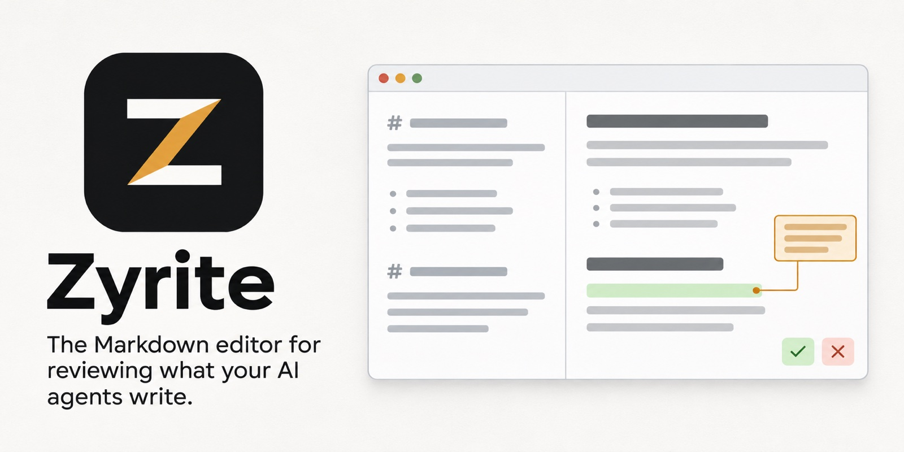
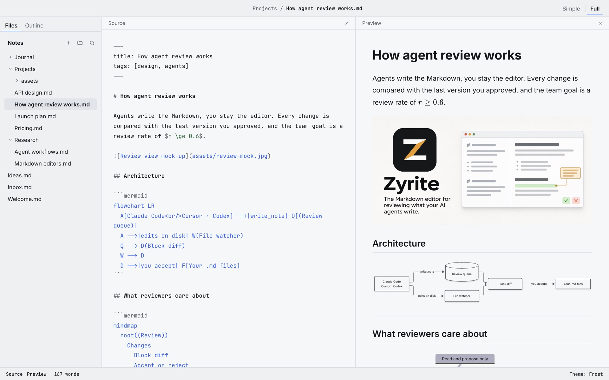
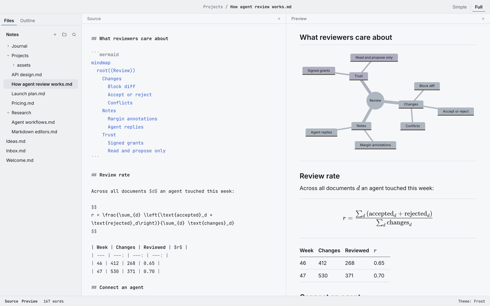
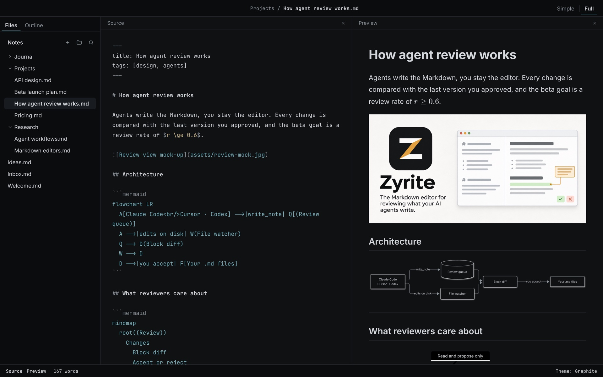
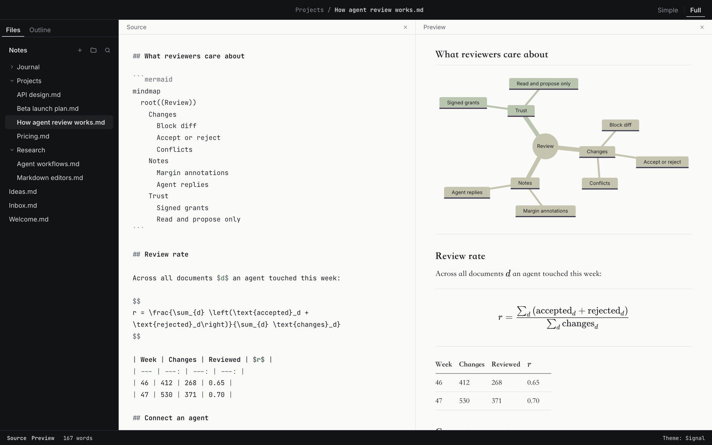

English | [简体中文](README-zh.md)

<p align="center"></p>

<p align="center">
  <a href="https://github.com/ZYAILLC/zyrite/actions/workflows/ci.yml"></a>
  <a href="https://github.com/ZYAILLC/zyrite/releases/latest"></a>
  <a href="LICENSE"></a>
  
</p>

Coding agents like Claude Code, Cursor and Codex now write a lot of Markdown: plans, specs, docs, notes. Zyrite is a desktop editor built for that loop. When an agent changes a file, you see exactly what changed and accept or reject it block by block. When you want something rewritten, you leave a note in the margin and the agent picks it up over MCP. Your files stay plain `.md` on your own disk.



## Features

### Review agent edits

- **Block-level diffs.** When an agent writes to a file, directly on disk or through MCP, Zyrite compares it with the last version you approved and marks each changed block.
- **Accept or reject each change**, or all at once. Step through changes with `⌥↑` / `⌥↓`.
- **Live writing indicator.** The editor follows the block an agent is writing right now.
- **Conflict handling.** If an agent's edit overlaps your unsaved changes, a side-by-side merge view lets you pick per block.
- **Margin annotations.** Select text and annotate it for an agent. Notes live in `.zyrite/`, never inside your Markdown, and agents reply and update their status over MCP.

### Write

- **Source + preview side by side**, with synced scrolling. Close either pane: source-only gives you live preview (CodeMirror 6), preview-only gives you WYSIWYG (ProseMirror).
- **Byte-faithful saving.** WYSIWYG rewrites only the blocks you edited and keeps your list markers, emphasis style, indentation and line endings. A one-word edit is a one-line `git diff`.
- CommonMark + GFM (tables, task lists, footnotes), YAML frontmatter, and inline HTML such as colored text, `<kbd>` and `<details>`.
- Math with KaTeX, including chemistry (`\ce{H2O}`).
- Diagrams: Mermaid (flowcharts, sequence, mind maps, pie, gantt and more), Graphviz `dot`, and Markmap mind maps from Markdown lists. Everything renders offline.
- Code highlighting for 100+ languages, color swatches after `#hex` / `rgb()` values, CSV and TSV blocks as tables.
- Obsidian syntax: `[[wikilinks]]`, `![[image.png|200]]` and `![[note#section]]` embeds, `#tags`, `> [!note]` callouts, `==highlights==`.
- Emoji shortcodes (`:rocket:`), superscript (`x^2^`), optional subscript (`H~2~O`), `[TOC]`, and local audio and video.
- Regex find and replace, multiple cursors, focus mode, typewriter mode, and a Color button for selected text.
- **Other text files, too:** YAML, JSON, TOML, `.conf` / `.ini`, XML, CSV, Dockerfiles, shell scripts, code and logs open in a plain-text editor with line numbers, folding and syntax highlighting. JSON, YAML and TOML are checked as you type. Logs open read-only and follow new lines. Files in GBK, Big5, Shift-JIS and other legacy encodings are detected and saved back in the same encoding. Nothing is ever run.



### Organize

- Open any folder as a vault: file tree, outline, and a file watcher that picks up outside changes instantly.
- `[[` completion. Renaming or moving a note offers to update every link that points to it.
- Command palette (`⌘K`), quick open (`⌘P`) and full-text search (`⌘⇧F`). Search matches substrings, so Chinese and other CJK text works without word segmentation.
- **Simple** and **Full** modes in one app. Switch with `⌘⇧E` when you just want a clean writing window.

### Connect your agents (MCP)

`zyrite mcp` is a stdio MCP server that ships with the app. Settings › MCP has copy-paste configs for Claude Code, Cursor and Codex.

| Tool | What it does |
| --- | --- |
| `list_notes` | List notes with titles and modified times |
| `search_notes` | Full-text search |
| `read_note` | Read a note and its frontmatter |
| `write_note` | Propose a change; it lands in the review queue, not on disk |
| `list_backlinks` | Backlinks with context |
| `get_annotations` | Read margin annotations |
| `reply_annotation` | Reply to an annotation and update its status |

The first time a program connects, Zyrite asks you to allow it. Grants are per vault and signed with a key kept in your system keychain. By default agents can read and propose changes; writing directly to disk is off.

### Built-in AI (bring your own model)

- Rewrite a selection: polish, continue, shorten, translate, change tone, or give your own instruction. Results stream in below the original.
- Works with any OpenAI-compatible API (OpenAI, DeepSeek and others) or a local Ollama model. Keys are stored in your system keychain, and requests go straight to your provider, never through a Zyrite server.

### Make it yours

- Three built-in themes: **Frost** (light), **Graphite** (dark) and **Signal** (dark sidebar, light page, amber accents). Light and dark can follow the system.
- Import Typora `.css` themes.
- Adjustable font size, line width and line height. Every shortcut can be rebound.
- Paste or drop images: saved next to your note from a path template, or uploaded through PicGo / PicList or a custom command.
- Export to PDF, single-file HTML, or Word (`.docx`, no pandoc needed).
- English by default, with Simplified Chinese in Settings.

<table>
  <tr>
    <td></td>
    <td></td>
  </tr>
  <tr>
    <td align="center">Graphite</td>
    <td align="center">Signal</td>
  </tr>
</table>

## Download

Get the installer for your platform from the [latest release](https://github.com/ZYAILLC/zyrite/releases/latest):

| Platform | Installer |
| --- | --- |
| macOS 12+ (Apple Silicon or Intel) | `.dmg` (`aarch64` or `x64`) |
| Windows 10/11 (x64 or Arm) | `-setup.exe`, or `.msi` for x64 |
| Linux (x64) | `.AppImage`, `.deb` or `.rpm` |

The installers are not code-signed, so the first launch shows a security prompt:

- **macOS:** if it says Zyrite can't be opened, go to *System Settings › Privacy & Security* and click *Open Anyway*.
- **Windows:** in the SmartScreen dialog, click *More info › Run anyway*.

You can also [build it from source](#build-from-source).

## Build from source

Requirements:

- Node.js 22+, pnpm 11 (`corepack enable`)
- Rust stable
- Platform prerequisites: <https://v2.tauri.app/start/prerequisites/>

```sh
pnpm install
pnpm dev          # run the desktop app (Tauri + Vite hot reload)
pnpm dev:web      # run only the frontend in a browser, no Rust needed
pnpm test         # frontend unit tests
pnpm typecheck
pnpm build        # build installers for the current platform into target/release/bundle/
cargo test --workspace
cargo clippy --workspace --all-targets -- -D warnings
```

## Project layout

```
apps/desktop/            Tauri app: src/ (React frontend) + src-tauri/ (Rust, wiring only)
crates/zyrite-core/      Core library: file I/O (atomic save, external change detection), vault (file tree,
                         watching, file operations), link and tag index, full-text search, recovery cache,
                         .zyrite/ data (baselines, pending reviews, annotations), vector index
crates/zyrite-mcp/       MCP server (stdio, `zyrite mcp --vault <path> [--lang en|zh-CN]`)
crates/zyrite-ai/        Model calls for the built-in AI (OpenAI-compatible APIs, Ollama; streaming, embeddings)
crates/zyrite-export/    Word (.docx) export
crates/zyrite-i18n/      Language for backend messages: English by default, Simplified Chinese optional
packages/md-blocks/      Markdown parsing, top-level block splitting, source positions, style detection
packages/editor-common/  Interfaces, rendering, and typography shared by both editors
packages/editor-live/    Live preview (CodeMirror 6)
packages/editor-wysiwyg/ WYSIWYG (ProseMirror, block-level write-back)
packages/themes/         Tokens for the 3 built-in themes (Frost, Graphite, Signal)
tests/corpus/            Fidelity regression corpus
.github/workflows/       CI and builds for three platforms
```

## Contributing

Issues and pull requests are welcome. Before opening a PR, please run `pnpm test`, `pnpm typecheck`, `cargo test --workspace` and `cargo clippy`. Any change to user-facing text needs both the English and the Simplified Chinese strings.

## License

[Apache-2.0](LICENSE). "Zyrite" and "纸砚" are trademarks of z-y.ai. The license does not grant trademark rights, so forks must ship under a different name. See [NOTICE](NOTICE).

Made by [z-y.ai](https://z-y.ai)
