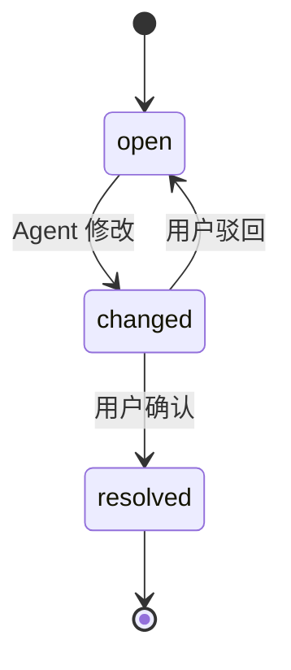

# 实现计划：批注同步到 MCP

## 背景

用户在 Zyrite 里给 Agent 写批注，Agent 通过 MCP 的 `get_annotations` 读取。现在批注只存在内存里，重启就丢。

## 改动清单

1. **存储层**（`crates/zyrite-core/src/annotations.rs`）
   - [ ] 定义 `Annotation` 结构体，字段见下表
   - [ ] 读写 `.zyrite/annotations/<file>.json`
     - 文件名用相对路径的 SHA-1，避免目录层级
     - 写入走 `write_atomic`
   - [x] 锚点重定位算法（已在 #42 完成）

2. **MCP 工具**（`crates/zyrite-mcp/src/tools.rs`）

   ```rust
   #[tool(description = "列出某个文件的批注")]
   async fn get_annotations(&self, file: String) -> Result<Vec<Annotation>> {
       self.store.load(&file).await
   }
   ```

3. **前端**：`AnnotationPanel.tsx` 订阅 `annotations://changed` 事件。

| 字段 | 类型 | 说明 |
|------|------|------|
| `id` | `String` | `an_` 前缀 + ULID |
| `anchor` | `Anchor` | 文本片段 + 前后文 |
| `status` | `"open" \| "changed" \| "resolved"` | 状态机见下 |

## 状态机



## 测试

```diff
- assert_eq!(store.load("a.md").len(), 0);
+ assert_eq!(store.load("a.md").unwrap().len(), 1);
```

> **注意**：测试要覆盖 Windows 路径（`C:\\Users\\...`）。

## 风险

- 并发写：两个 Agent 同时 `reply_annotation` → 用文件锁
- 大文件：单文件超过 1,000 条批注时分页

---

*预计 2 天。* 完成后运行 `cargo test -p zyrite-core annotations` 和 `pnpm test`。
