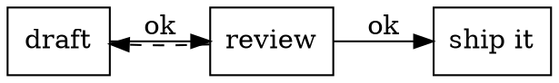
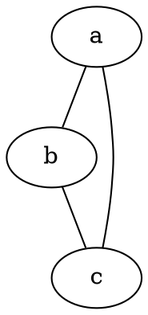

# Diagrams, data tables and media

A Graphviz graph:



The same with the `graphviz` language name:



A mind map:

```markmap
# Zyrite
## Editing
- WYSIWYG
- Source
## Review
- Agents
- Annotations
```

CSV with quoted fields, an embedded newline and an escaped quote:

```csv
name,role,note
"Smith, Jane",editor,"says ""hi"""
Li Lei,writer,"line one
line two"
short row
```

TSV:

```tsv
id	title	done
1	Draft	yes
2	Review	no
```

Media through image syntax:  and .

A remote video stays a link: 

Obsidian embeds:

![[a.mp4]]

![[song.mp3|Theme]]

![[clip.mov|320]]
