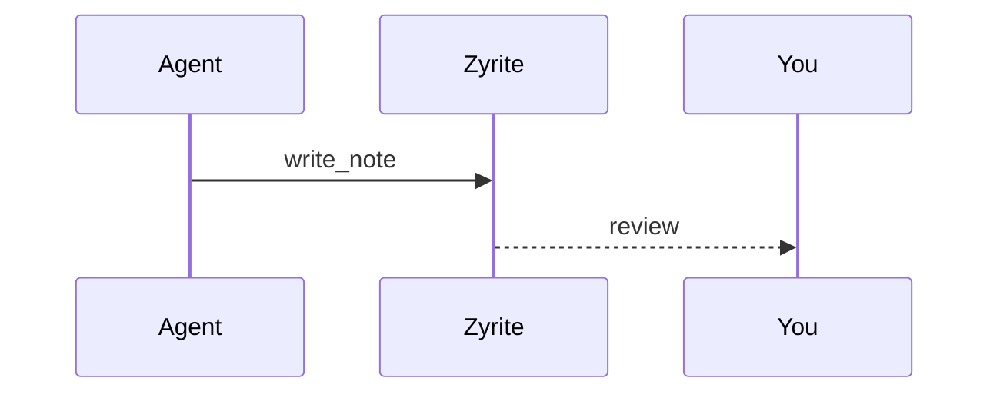
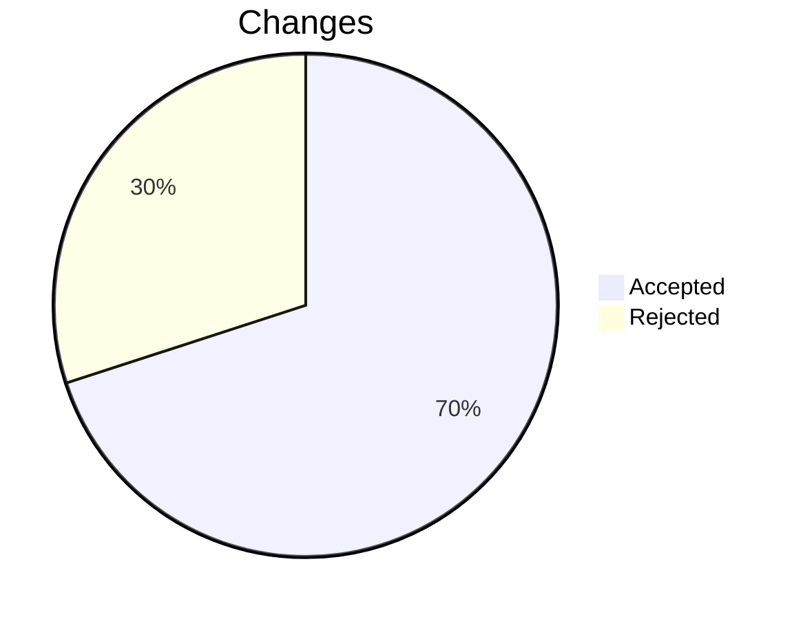
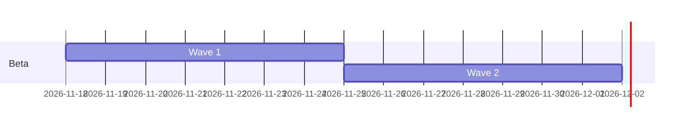
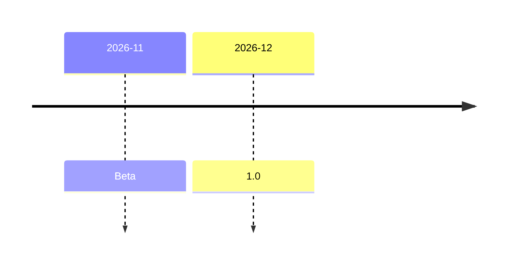
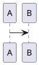
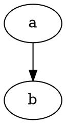

# Rich syntax

## 1 Inline
**bold** *italic* ~~strike~~ ==highlight== `code` [link](https://example.com) <https://auto.link> #tag [[Welcome]]
H~2~O and x^2^ (Pandoc sub/sup) · :smile: :rocket: (emoji shortcodes) · 😀 (unicode emoji)

## 2 Inline HTML
<span style="color:#d33">red text</span> · <mark>mark</mark> · <kbd>Ctrl</kbd>+<kbd>C</kbd> · H<sub>2</sub>O · x<sup>2</sup> · <u>underline</u> · <font color="blue">font tag</font>

## 3 HTML blocks
<details>
<summary>Click to expand</summary>

Hidden content
</details>

<div align="center"></div>

## 4 Color codes
`#E0A040` · `rgb(47, 91, 234)` · `hsl(150 60% 40%)`

## 5 Footnotes
A claim with a footnote.[^1]

[^1]: The footnote text.

## 6 Math
Inline $E = mc^2$, chemistry $\ce{H2O + CO2 -> H2CO3}$, color $\color{red}{x}$

$$
\begin{aligned} f(x) &= \int_0^\infty e^{-t} t^{x-1}\,dt \\ \mathbf{A} &= \begin{pmatrix}1 & 2\\3 & 4\end{pmatrix} \end{aligned}
$$

## 7 Callout
> [!warning] Heads up
> Callout body text.

## 8 Embeds
![[review-mock.jpg]]


## 9 Definition list
Term
: Definition

## 10 TOC
[TOC]

## 11 Code
```python
def hello(name: str) -> str:
    return f"Hello {name}"
```
```diff
- old line
+ new line
```

## 12 Diagrams






```chart
{"type":"bar","data":[1,2,3]}
```

## 13 Media
<video src="demo.mp4" controls width="240"></video>
<iframe src="https://example.com" width="240" height="120"></iframe>
