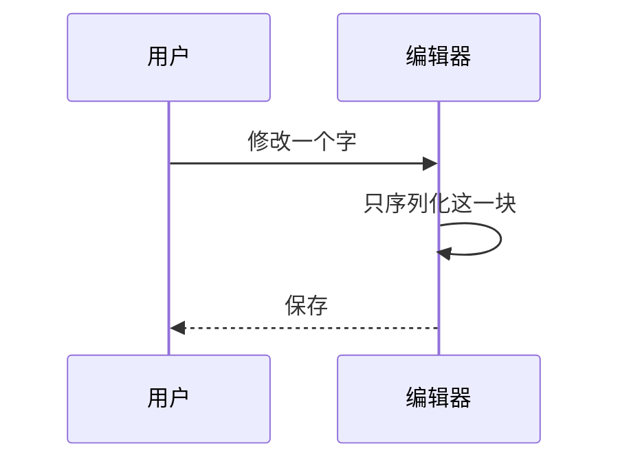

# 块级回写

#editor #fidelity/wysiwyg

所见即所得模式下，只重写被编辑过的块。相关：[[原文保真]]、[[CodeMirror 6|CM6]]、[[ProseMirror#Schema]]。

## 为什么不整篇重新序列化

- 序列化器会统一风格：`*` 变 `-`，`__` 变 `**`
- 会改掉用户故意保留的写法
	- 例如 Tab 缩进的子列表
	- 以及行尾两个空格的硬换行

## 流程

Tags inline: 这是 #中文标签 和 #nested/tag/deep 的测试，但 C# 和 a#b 不是标签，#123 也不是。

![[块级回写示意图.excalidraw]]
